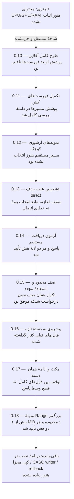

# گراف شواهد و گام‌های باقی‌مانده

نمودار ترتیب و وضعیت است، نه نمودار حجم/درصد پیشرفت. سبز بودن آزمون‌ها به معنی نصب کامل نیست.

[نسخهٔ آفلاین HTML](graph.html) | [دادهٔ قابل ویرایش](graph.json) | [شواهد](EVIDENCE-SUMMARY.json)
