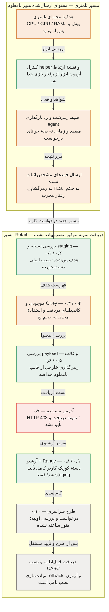

# گراف جلسه

گراف مراحل و مرزهای شواهد است، نه اثبات کل به‌روزرسانی. متن کامل خام چت در این انتقال نیست.

نسخهٔ قابل خواندن آفلاین: [graph.html](graph.html). دادهٔ قابل‌ویرایش: [graph.json](graph.json). [شواهد خلاصه](EVIDENCE-SUMMARY.json) و [محدودهٔ پوشش](COVERAGE-fa.md).
